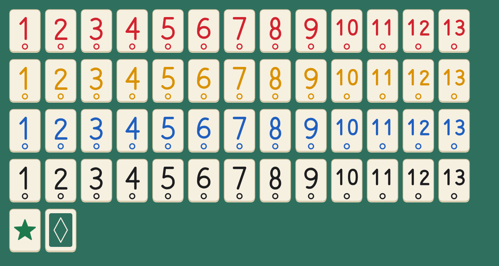

# okey-tasi-svg

Okey taşları için SVG seti: 52 sayılı taş (4 renk, 1'den 13'e), sahte okey ve taşın arka yüzü. Her şey bu depodaki betikle üretilir, rakamlar yazı tipine bağlı olmayan yollar olarak çizilir, bu yüzden her cihazda ve her tarayıcıda aynı görünür.



## İçerik

| | |
|---|---|
| `svg/<renk>-<sayı>.svg` | 52 sayılı taş. Renkler: `kirmizi`, `sari`, `mavi`, `siyah`. Sayılar iki haneli yazılır: `kirmizi-07.svg`, `mavi-13.svg`. |
| `svg/sahte-okey.svg` | Sahte okey, yeşil beş köşeli yıldız. |
| `svg/arka.svg` | Taşın arka yüzü. |
| `sprite.svg` | Tüm taşlar tek dosyada, her biri `<symbol>` olarak. Kimlikler dosya adlarıyla aynıdır (uzantısız). |
| `taslar.json` | Hangi taştan kaç tane olduğunu ve dosya adlarını anlatan liste. |
| `onizleme.html`, `onizleme.png` | Tüm taşların tek sayfada önizlemesi. |

Tam bir okey takımı 106 taştır: her renkte 1-13 arası sayılardan ikişer tane (104 taş) ve iki sahte okey. `taslar.json` içindeki `adet` alanı bunu belirtir, `toplamTas` alanı 106'dır. Aynı taşın iki kopyası aynı dosyayı kullanır.

## Kullanım

```html

```

Her SVG kendi `<title>` ve `<desc>` öğesini taşır (`Kırmızı 7`), ekran okuyucular için ek bir şey gerekmez. Taşların oranı 80 x 110'dur (`viewBox="0 0 80 110"`), istediğin boyuta ölçekleyebilirsin.

### Tek dosyada sprite

54 ayrı istek yerine `sprite.svg` tek seferde yüklenir. Sembolün kimliği dosya adıdır:

```html
<svg width="80" height="110" role="img" aria-label="Kırmızı 7">
  <use href="sprite.svg#kirmizi-07"/>
</svg>
```

Sprite'ı yeniden üretmek için `npm run sprite`. Testlerden biri `sprite.svg`'nin güncel olduğunu denetler.

JavaScript ile bir takım kurmak için:

```js
import { readFileSync } from 'node:fs';

const { taslar, arka } = JSON.parse(readFileSync('taslar.json', 'utf8'));
const takim = taslar.flatMap((t) => Array(t.adet).fill(t.dosya)); // 106 dosya adı
```

## Yeniden üretmek

Renkleri ya da boyutları değiştirmek için `taslar.mjs` dosyasını düzenle:

```bash
npm run uret            # svg/ ve taslar.json dosyalarını yeniden yazar
node onizleme.mjs       # onizleme.html dosyasını yeniler
npm test
```

Node.js 18 veya üzeri gerekir, başka bir paket gerekmez.

## Tasarım notları

- Rakamlar `taslar.mjs` içinde elle tanımlanmış çizgi yollarıdır (yuvarlak uçlu çizgiler). Bir yazı tipinden alınmamıştır.
- Renkli taşın altındaki küçük halka, taşın rengini rakamdan bağımsız da gösterir.
- Taşlar düz renkli geometrik çizimlerdir. Gerçekçi taş dokusu ya da gölgelendirme yoktur.

## Erişilebilirlik ve sınırlar

Rakam renklerinin taş zeminine (`#f6f0e1`) kontrast oranları, WCAG formülüyle hesaplanmıştır:

| Renk | Kontrast |
|---|---:|
| Siyah | 14,80 |
| Mavi | 5,36 |
| Yeşil (sahte okey) | 4,68 |
| Kırmızı | 4,61 |
| **Sarı** | **2,31** |

Sarı, grafik öğeler için önerilen 3:1 oranının altındadır. Renk körlüğü ya da düşük ekran parlaklığında sarı taşlar zor ayırt edilebilir. Daha koyu bir sarı gerekiyorsa `taslar.mjs` içindeki `RENKLER.sari.kod` değerini değiştirip yeniden üret. Kırmızı ile yeşil renk körlüğü olan kullanıcılar için birbirine yakın görünebilir, ama sahte okeyin şekli (yıldız) bu ayrımı renge bağımlı bırakmaz.

- Bu bir oyun motoru değildir. Taş dağıtımı, gösterge ve okey taşının belirlenmesi, per kontrolü gibi oyun kuralları yoktur, yalnızca görseller vardır.
- Taşların yalnızca ön ve arka yüzü vardır, taşın yan ya da üst görünümü yoktur.

## Test

```bash
npm test
```

Testler manifestin 106 taşı tuttuğunu, her SVG'nin iyi biçimli olduğunu, başlıkların doğru olduğunu, her renkli taşın yalnızca kendi rengini kullandığını ve üretimin belirgin olduğunu (depodaki dosyalar betiğin çıktısıyla aynı) denetler. Playwright kuruluysa ayrıca 54 görselin tarayıcıda çizilip hepsinin birbirinden farklı ve boş olmadığı doğrulanır, kurulu değilse bu test atlanır.

## Lisans

MIT, bkz. [LICENSE](LICENSE). Çizimlerin hepsi bu depodaki betikle üretilir, başka bir çalışmadan ya da yazı tipinden alınmamıştır.
